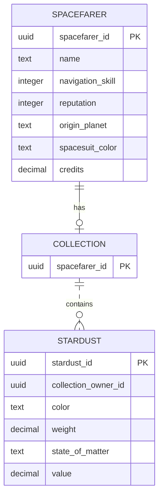

# Data model

The types above are simplified. All three tables also have a client key and the creation/change fields from `ZDS1910_S_ADMIN_DATA`. The diagram shows application relationships, not database foreign-key constraints.

| Entity | Table | Main type choices |
| --- | --- | --- |
| Spacefarer | `ZDS1910_T_SFARER` | UUID key; skill/reputation INT4; Credits DEC(15,2) |
| Collection | `ZDS1910_T_SCOLL` | Owner's UUID as its key |
| Stardust | `ZDS1910_T_SDUST` | Independent UUID key; weight DEC(13,3); value DEC(15,2) |

## Main decisions

- A Spacefarer can have zero or one Collection. Collection uses its owner's UUID as its key. A missing Collection and an existing, empty Collection are different states.
- Collection is a child of the Spacefarer RAP business object. Stardust is a separate root object: trading changes its owner, keeping its identity and properties. A first purchase creates the buyer's Collection if needed.
- Collection item count and base value are calculated in `ZDS1910_I_COLLECTIONVALUE`. `ZDS1910_I_WEALTH` adds available Credits to the Collection value. Empty Collections contribute zero. Weight is expressed in KG; balances and values use Credits.

## Package layout

| Package | Contents |
| --- | --- |
| `ZDS1910_P_GAP` | Setup, sample data and integration-test runners |
| `ZDS1910_P_GAP_BA` | Tables, shared admin structure, aggregates and permission view |
| `ZDS1910_P_GAP_BO` | Business views, behaviors, trading logic and service objects |

Application permissions are stored separately in `ZDS1910_T_UAUTH`, keyed by client, technical user and activity. A technical user is not assigned to a particular Spacefarer.
